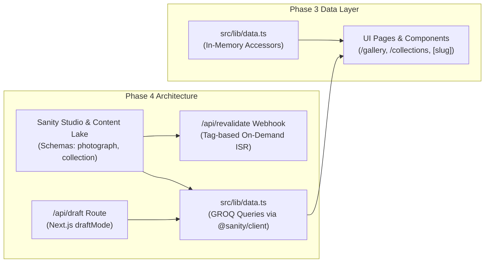

# PROJECT CONTEXT & HANDOFF SPECIFICATION

**Project:** Personal Travel Photography Portfolio × Fine-Art Exhibition  
**Photographer:** Harikrishnan Nandanan  
**Watermark:** `HARI`  
**Copyright:** `© 2026 Hari. All rights reserved.`  
**Primary Camera:** Canon EOS R6 Mark III  
**Current Milestone:** Phase 3 Complete (Main Photography Gallery, Canonical Photograph Pages & Thematic Travel Collections Approved)  
**Next Milestone:** Phase 4 (Sanity CMS & Real-Time Publishing Workflow)

---

## 1. Project Vision & Creative Philosophy

### Core Creative Direction
* **Personal Portfolio × Fine-Art Exhibition Aesthetic:** The website is fundamentally a **personal travel photography portfolio for a hobbyist**, presented through the visual language and cinematic atmosphere of a premium fine-art exhibition.
* **Authentic Personal Identity:**
  * **Photographer:** Harikrishnan Nandanan.
  * **Role & Background:** A hobbyist photographer who enjoys travelling, exploring unfamiliar places, and taking photographs along the way.
  * **Personal Passion, Not a Business:** Photography is a creative hobby and a personal medium for documenting light, places, and memories. **Harikrishnan does not own a photography studio, operate a commercial business, offer photography services for hire, or have gallery representation.**
  * **Tagline:** *Photography · Travel · Visual Stories*
  * **Primary Camera:** **Canon EOS R6 Mark III**. (No unverified lens collections, artificial gear catalogues, or invented equipment).
  * **Watermark & Copyright:** Monumental footer watermark displays **`HARI`**; bottom colophon reads **`© 2026 Hari. All rights reserved.`**
* **Zero Fictional Claims:** The portfolio strictly eliminates all fabricated commercial jargon ("Studio & Inquiries", "Commissions Worldwide", "Available for Assignments"), fabricated awards, fake Steidl monographs, invented Biennales, or fake representation relationships. Factual contact information is decoupled into configurable placeholders.
* **Photographic Integrity & Equipment Attribution:** The Canon EOS R6 Mark III is Harikrishnan's personal camera. Temporary sample placeholder photographs are never attributed this camera, invented lenses, or fabricated EXIF settings. Photographic telemetry is displayed only when authentic data is available.
* **Multi-Genre Breadth:** Accommodates landscapes, travel, street scenes, wildlife, people, and architectural geometry. It is not confined to monochrome or brutalist themes.
* **The Exhibition Atmosphere:** Uses numbered exhibition plates (`PLATE 00`, `PLATE 01`...), thematic travel series (*Wanderings & Wild Places*, *City Streets & Travel Notes*, *Forms & Spaces*), editorial captions, and museum-grade negative space to give personal travel photography an elevated, cinematic presentation.

---

## 2. Approved Design System ("The Curated Monolith")

### Color Palette
* **Obsidian Foundation:** `#08080a` (Deepest canvas surface background)
* **Pitch Surface:** `#030304` (Sub-surface layer for modals, dossiers, and photo mats)
* **Carbon Cards:** `#111114` & `#141418` (Plate containers and card backgrounds)
* **Primary Text (Bone White):** `#f4f2ec` (Contrast ratio `18.2:1`, WCAG AAA compliant against `#08080a`)
* **Muted Text (Pewter):** `#c8c5bc` & `#a1a1aa` (Legible descriptions and technical metadata)
* **Exhibition Accents:** Warm Bronze `#d4a373` & Subtle Amber `#e09f58`
* **Hairline Borders:** `rgba(255, 255, 255, 0.08)` to `rgba(255, 255, 255, 0.15)`

### Typography Matrix
* **Editorial Display Serif:** *Cormorant Garamond* (Google Font weights 300, 400, 500, 600, and Italic). Used for plate titles, exhibition headlines, and curatorial quotes.
* **Body / Interface Sans:** *Inter* (`font-light`, `leading-relaxed`). Used for curatorial essays, personal biography, and interface labels.
* **Plate Telemetry Monospace:** *JetBrains Mono* (`tracking-[0.25em]`, uppercase). Used for plate numbers, camera telemetry, categories, and timestamps.
* **Preconnected Web Fonts:** Loaded via `<link>` in `src/app/layout.tsx` to eliminate build-time Google Font network failures.

### Textures & Atmosphere
* **Analogue Film Grain:** Embedded SVG fractal noise overlay (`.film-grain`) at 3.5% opacity with `pointer-events-none` across the viewport, providing an authentic silver-halide texture.
* **Lens Falloff Vignette:** Radial dark falloff gradient (`.vignette-overlay`) on hero imagery mimicking large-format lens characteristics.

### Animation Principles
* **Intensity:** Balanced and restrained.
* **Transitions:** Smooth, natural easing (`transition-all duration-300` / `duration-500` / `duration-700`).
* **Hover States:** Subtle scale decompression (`scale-[1.015]` to `scale-[1.02]`), gentle exposure lift, and border warmth shifts from white/10 to bronze/50.
* **Scroll Behavior:** Native browser momentum scrolling without scroll hijacking.
* **Accessibility:** Full support for `prefers-reduced-motion: reduce`.

---

## 3. Technology Stack & Exact Versions

* **Framework:** Next.js `16.4.6` (App Router)
* **UI Library:** React `19.3.0` & React DOM `19.3.0`
* **Language:** TypeScript `^5` (Strict typing enabled in `tsconfig.json`)
* **Styling:** Tailwind CSS `4.3.3` with `@tailwindcss/postcss` `4.3.3`
* **Bundler Pipeline:** Webpack compiler pipeline (`next build --webpack` / `next dev --webpack`)
* **Icons:** `lucide-react@1.72.0`
* **Image Optimization:** Next.js `<Image>` component with AVIF and WebP format negotiation and Unsplash remote pattern whitelist.

---

## 4. Project Architecture & File Mapping

```
photography-portfolio/
├── package.json                   # Dependencies, build scripts & magic-string override
├── postcss.config.mjs             # PostCSS plugin registration (@tailwindcss/postcss)
├── next.config.ts                 # Next.js configuration (AVIF/WebP, remote image patterns)
├── tsconfig.json                  # Strict TypeScript configuration
├── PROJECT_CONTEXT.md             # Master context handoff document
│
└── src/
    ├── app/
    │   ├── layout.tsx             # Global shell: font preconnect, metadata, film grain overlay
    │   ├── globals.css            # Tailwind 4 @theme, custom palette, grain overlay utilities
    │   ├── page.tsx               # Homepage controller wiring all sections & modal inspector state
    │   │
    │   ├── gallery/
    │   │   ├── layout.tsx         # Metadata shell for the primary photography gallery
    │   │   ├── page.tsx           # Primary editorial gallery with category & journey filtering
    │   │   │
    │   │   └── [slug]/
    │   │       ├── page.tsx       # Dedicated canonical photograph dossier & exhibition steppers
    │   │       └── not-found.tsx  # Styled 404 plate for invalid photograph URLs
    │   │
    │   └── collections/
    │       ├── layout.tsx         # Metadata shell for travel journeys
    │       ├── page.tsx           # Travel collections index page
    │       │
    │       └── [slug]/
    │           ├── page.tsx       # Dedicated travel journey dossier with curated plate sequence
    │           └── not-found.tsx  # Styled 404 plate for invalid collection URLs
    │
    ├── components/
    │   ├── Navigation.tsx         # Route-aware sticky header, active states, mobile drawer
    │   ├── Hero.tsx               # Plate 00 (High Sierra lake reflection), dual CTAs, plate slate
    │   ├── EditorialIntro.tsx     # Personal premise, 4-point exhibition metrics grid
    │   ├── FeaturedGallery.tsx    # Homepage featured plates grid with full gallery CTA
    │   ├── SeriesShowcase.tsx     # Curated travel journeys linking to /collections/[slug]
    │   ├── AboutSection.tsx       # Personal bio, Canon EOS R6 Mark III, portrait placeholder
    │   ├── Footer.tsx             # "Let's Connect" section, HARI watermark, © 2026 Hari colophon
    │   ├── PhotoDetailModal.tsx   # Fullscreen plate inspector with link to dedicated plate page
    │   └── CopyLinkButton.tsx     # Tactile clipboard copy button with visual confirmation state
    │
    ├── data/
    │   └── mockData.ts            # Backwards-compatible re-exports from lib/data.ts
    │
    └── lib/
        └── data.ts                # CMS-independent data model, mock archive, and typed query layer
```

---

## 5. Existing Routes & Navigation

| Route | Type | Description |
| :--- | :--- | :--- |
| `/` | Static (`○`) | **Homepage Exhibition Prologue:** Full-bleed Hero, Curatorial Premise, Selected Plates Gallery, Curated Journeys, About the Photographer, Let's Connect Footer, and Photographic Inspector Modal. |
| `/gallery` | Static (`○`) | **Primary Photography Gallery:** Full editorial exhibition archive with dual filtering: Category tabs (`LANDSCAPES`, `TRAVEL & STREETS`, `NATURE & WILDLIFE`, `PEOPLE & PORTRAITS`, `ARCHITECTURE`) and Journey tabs (`WANDERINGS & WILD PLACES`, `CITY STREETS & TRAVEL NOTES`, `FORMS & SPACES`), live plate count, and single-click filter reset. |
| `/gallery/[slug]` | SSG (`●`) | **Canonical Photograph Page:** Aspect-ratio-locked fine-art presentation on `#030304` obsidian backing, curatorial dossier, authentic telemetry slate, tactile Copy Link button, cyclic Previous/Next plate steppers, and related sibling plates. |
| `/collections` | Static (`○`) | **Travel Collections Index:** Overview of Harikrishnan's three personal travel journeys with cover visuals, narrative introductions, and dynamically derived plate counts. |
| `/collections/[slug]` | SSG (`●`) | **Travel Journey Dossier:** Narrative expedition journal presenting the story and curated sequence of plates belonging to that specific journey. |

### Navigation Anchors & Cross-Route Routing
* On `/` (Homepage): Anchors `#works`, `#series`, `#about`, `#contact` scroll smoothly using `scroll-mt-28`.
* On Subpages (`/gallery`, `/collections`, etc.): `Navigation.tsx` dynamically detects `usePathname()`, pointing `About` and `Connect` back to `/#about` and `/#contact`, while providing active bronze underline indicators on `Photographs` and `Journeys`.

---

## 6. Implemented Features & Phase Status

| Component / Feature | Implementation Details | Status |
| :--- | :--- | :--- |
| **Sticky Navigation** | Route-aware via `usePathname()`, scroll threshold detection (`scrollY > 30`), glass backdrop blur, brand title, active route indicators, mobile drawer, and 3D badge. | **Complete & Verified** |
| **Cinematic Hero** | Plate 00 (*Morning Mist on Alpine Waters*), fluid typography (`text-4xl` to `text-8xl`), dual CTAs ("Explore Photographs" -> `/gallery`, "View Plate Notes" -> modal), and plate telemetry slate. | **Complete & Verified** |
| **Editorial Premise** | Personal reflection on light and travel, paired with a 4-point hobbyist metrics bar (*EOS R6 Mark III*, *Travel & Nature*, *Observant Gaze*, *Creative Hobby*). | **Complete & Verified** |
| **Featured Gallery** | Asymmetric editorial grid with varied aspect ratios (`16:9`, `4:5`, `3:2`, `1:1`, `2.39:1`). Includes link to complete archive at `/gallery`. | **Complete & Verified** |
| **Primary Gallery (`/gallery`)** | Single focused cinematic editorial gallery. Combined Category & Journey filters, live count, reset filters action, responsive asymmetric layouts. | **Complete & Verified** |
| **Photograph Dossiers (`/gallery/[slug]`)** | Aspect-ratio-locked presentation, curatorial notes, authentic optional telemetry, tactile Copy Link button, cyclic Prev/Next navigation, related sibling plates, and dynamic OpenGraph metadata. | **Complete & Verified** |
| **Custom 404 Handlers** | Elegant Curated Monolith not-found plates for missing photographs (`/gallery/[slug]/not-found.tsx`) and missing collections (`/collections/[slug]/not-found.tsx`). | **Complete & Verified** |
| **Travel Collections (`/collections` & `[slug]`)** | Personal travel journey cards and dedicated expedition dossiers with curated plate sequences. | **Complete & Verified** |
| **Photo Detail Modal** | Fullscreen frosted preview modal (`#050507/95 backdrop-blur-2xl`) retained on homepage with direct deep-link action to the canonical plate dossier. | **Complete & Verified** |
| **About the Photographer** | Natural personal introduction of Harikrishnan Nandanan, Canon EOS R6 Mark III "Behind the Lens" feature, minimal portrait placeholder frame, and Let's Connect card. | **Complete & Verified** |
| **Personal Footer** | Friendly "Let's Connect" message, directory columns, Back to Top smooth scroll, monumental `HARI` watermark, and `© 2026 Hari. All rights reserved.` colophon. | **Complete & Verified** |

---

## 7. Photography Data Model & Access Layer

The data model in `src/lib/data.ts` is strictly decoupled from UI components and designed for direct mapping to Sanity CMS in Phase 4.

### 7.1 TypeScript Interface Specification
```typescript
export interface Photograph {
  // Required fields
  id: string;
  slug: string;
  title: string;
  imageUrl: string;
  alt: string;
  category: "Landscapes" | "Travel & Streets" | "Nature & Wildlife" | "People & Portraits" | "Architecture";
  displayOrder: number;

  // Optional fields (displayed ONLY when authentic data exists)
  plateNumber?: string;
  aspectRatio?: "4:5" | "16:9" | "1:1" | "2.39:1" | "3:2";
  caption?: string;
  description?: string;
  notes?: string;
  location?: {
    placename: string;
    region: string;
    country?: string;
  };
  captureDate?: string;
  year?: string;
  collectionSlug?: string;
  series?: string;
  cameraModel?: string;
  lens?: string;
  focalLength?: string;
  aperture?: string;
  shutterSpeed?: string;
  iso?: string;
  featured?: boolean;
  isPlaceholder?: boolean;
  sampleNote?: string;
}

export interface Collection {
  id: string;
  slug: string;
  title: string;
  journeyNumber: string;
  subtitle: string;
  description: string;
  coverImage: string;
  yearRange?: string;
  // Plate count is dynamically derived from photograph records to prevent data duplication
}
```

### 7.2 Data-Access Abstraction Functions
* `getAllPhotographs(): Photograph[]` — Sorted by `displayOrder`.
* `getFeaturedPhotographs(): Photograph[]` — Filtered by `featured: true`.
* `getPhotographBySlug(slug: string): Photograph | undefined`
* `getAdjacentPhotographs(slug: string): { prev: Photograph | null; next: Photograph | null }` — Enables continuous cyclic navigation.
* `getPhotographsByCollection(collectionSlug: string): Photograph[]`
* `getPhotographsByCategory(category: PhotographCategory): Photograph[]`
* `getAllCollections(): (Collection & { count: number })[]` — Dynamically computes plate counts.
* `getCollectionBySlug(slug: string): (Collection & { count: number }) | undefined`

---

## 8. Quality Assurance & Real Browser Verification

A real browser test suite was executed against the production build using Google Chrome headless driven by the Chrome DevTools Protocol (CDP) on `http://localhost:3001`.

### 8.1 Test Matrix & Verification Results
* **Homepage to Gallery Navigation:** Verified Hero CTA navigated to `/gallery` (`PASSED`).
* **Category Filtering:** Tested clicking `LANDSCAPES` and `ARCHITECTURE`; verified dynamic filtering and plate rendering (`PASSED`).
* **Collection Filtering & Reset:** Tested combined category + journey filtering; verified "Reset Filters" restored the complete 15-plate archive (`PASSED`).
* **Photograph Dossier & Hardware Uncoupling:** Navigated to `/gallery/morning-mist-on-alpine-waters`; verified that Canon EOS R6 Mark III was **not** attributed to the sample image, verified the placeholder disclaimer was present, and tested the tactile Copy Link button (`PASSED`).
* **Previous / Next Navigation:** Tested cyclic navigation through `/gallery/mountain-ridges-in-morning-sun` and back (`PASSED`).
* **Collections Navigation:** Verified 3 journey cards on `/collections` and explored `/collections/wanderings-and-wild-places` (`PASSED`).
* **Browser History:** Tested native `window.history.back()` and `.forward()` (`PASSED`).
* **Custom 404 Handlers:** Tested `/gallery/non-existent-plate` and `/collections/non-existent-journey`; verified styled fine-art 404 plates rendered (`PASSED`).
* **Responsive Testing:** Verified tablet (768×1024) and mobile (390×844) layouts with slide-over drawer (`PASSED`).

### 8.2 Build & Strict Verification Metrics
* `npx tsc --noEmit`: **0 errors** (Strict TypeScript validation passed).
* `npm run build`: Compiled in **1.6 seconds**; all **24 static pages** generated (`24/24` SSG/Static).

---

## 9. Architectural Blueprint for Sanity CMS Integration (Phase 4)

The Phase 3 architecture provides a clean bridge to Sanity CMS without requiring changes to UI components:



### Key Considerations & Requirements for Phase 4:
1. **Publishing New Photographs Without Code Deployments:**
   * Next.js App Router dynamic routes (`/gallery/[slug]` and `/collections/[slug]`) operate with `dynamicParams = true` (default). When a new photograph is published in Sanity, visiting its slug triggers server-side on-demand generation and edge caching without requiring a code commit or rebuild.
2. **Instant Updates & Deletions (On-Demand ISR):**
   * Create an `/api/revalidate` route handler secured with a shared webhook signature.
   * On Sanity document publish/delete events, the webhook invokes `revalidateTag("photographs")` and `revalidatePath("/gallery")`. Content updates globally within milliseconds.
3. **Draft Previews (`draftMode()`):**
   * Integrate Next.js `draftMode()`:
     * A `/api/draft?slug=...` route handler validates credentials and sets preview cookies.
     * `src/lib/data.ts` checks `(await draftMode()).isEnabled` and passes `perspective: "previewDrafts"` with a server-side read token to fetch unpublished drafts directly into the live layout.
4. **Secure Image Delivery & Asset Processing:**
   * Add `cdn.sanity.io` to `next.config.ts` remote patterns.
   * Integrate `@sanity/image-url` to generate responsive focal-point crops and WebP/AVIF formats.
   * Extract blurhash/`lqip` metadata from Sanity image assets for zero-CLS progressive blur placeholders.

---

## 10. Remaining Issues & Known Limitations

1. **Sample Photographs are Placeholders:** All currently displayed photographs are curated Unsplash placeholders used to test aspect ratios and layout contrast. Harikrishnan's actual photographs will be uploaded via Sanity CMS in Phase 4.
2. **Portrait Frame is a Placeholder:** The About section currently displays a clean, fine-art geometric placeholder frame with a camera silhouette icon (`[ Portrait Placeholder ] Harikrishnan Nandanan`) until Harikrishnan provides his personal portrait.

---

## 11. Verification & Command Reference

```powershell
# Start local development server (serves at http://localhost:3000)
npm run dev

# Run strict TypeScript type verification (currently 0 errors)
npx tsc --noEmit

# Run optimized production build (currently compiles in ~1.6s with 0 errors)
npm run build
```
