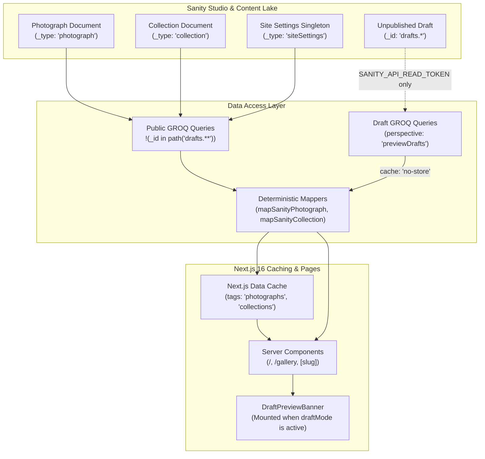

# PROJECT CONTEXT & HANDOFF SPECIFICATION

**Project:** Personal Travel Photography Portfolio × Fine-Art Exhibition  
**Photographer:** Harikrishnan Nandanan  
**Watermark:** `HARI`  
**Copyright:** `© 2026 Hari. All rights reserved.`  
**Primary Camera:** Canon EOS R6 Mark III  
**Current Milestone:** Phase 4 Complete (Sanity CMS Integration, Studio, Data Mapping, Secure Draft Previews, and Webhook Revalidation)  
**Next Milestone:** Phase 5 (Animation & Micro-interactions: Framer Motion, Kinetic Reveal & Telemetry Transitions)

---

## 1. Project Vision & Creative Philosophy

### Core Creative Direction
* **Personal Portfolio × Fine-Art Exhibition Aesthetic:** The website is fundamentally a **personal travel photography portfolio for a hobbyist**, presented through the visual language and cinematic atmosphere of a premium fine-art exhibition.
* **Authentic Personal Identity:**
  * **Photographer:** Harikrishnan Nandanan.
  * **Role & Background:** A hobbyist photographer who enjoys travelling, exploring unfamiliar places, and taking photographs along the way.
  * **Personal Passion, Not a Business:** Photography is a creative hobby and a personal medium for documenting light, places, and memories. **Harikrishnan does not own a photography studio, operate a commercial business, offer photography services for hire, or have gallery representation.**
  * **Tagline:** *Photography · Travel · Visual Stories*
  * **Primary Camera:** **Canon EOS R6 Mark III**. (No unverified lens collections, artificial gear catalogues, or invented equipment).
  * **Watermark & Copyright:** Monumental footer watermark displays **`HARI`**; bottom colophon reads **`© 2026 Hari. All rights reserved.`**
* **Zero Fictional Claims:** The portfolio strictly eliminates all fabricated commercial jargon ("Studio & Inquiries", "Commissions Worldwide", "Available for Assignments"), fabricated awards, fake Steidl monographs, invented Biennales, or fake representation relationships. Factual contact information is decoupled into configurable placeholders in Sanity `siteSettings`.
* **Photographic Integrity & Equipment Attribution:** The Canon EOS R6 Mark III is Harikrishnan's personal camera. Individual photograph EXIF fields are strictly optional. Photographic telemetry is displayed only when authentic data is available in Sanity; camera metadata is never fabricated.
* **Multi-Genre Breadth:** Accommodates landscapes, travel, street scenes, wildlife, people, and architectural geometry.
* **The Exhibition Atmosphere:** Uses numbered exhibition plates (`PLATE 00`, `PLATE 01`...), thematic travel series (*Wanderings & Wild Places*, *City Streets & Travel Notes*, *Forms & Spaces*), editorial captions, and museum-grade negative space to give personal travel photography an elevated, cinematic presentation.

---

## 2. Approved Design System ("The Curated Monolith")

### Color Palette
* **Obsidian Foundation:** `#08080a` (Deepest canvas surface background)
* **Pitch Surface:** `#030304` (Sub-surface layer for modals, dossiers, and photo mats)
* **Carbon Cards:** `#111114` & `#141418` (Plate containers and card backgrounds)
* **Primary Text (Bone White):** `#f4f2ec` (Contrast ratio `18.2:1`, WCAG AAA compliant against `#08080a`)
* **Muted Text (Pewter):** `#c8c5bc` & `#a1a1aa` (Legible descriptions and technical metadata)
* **Exhibition Accents:** Warm Bronze `#d4a373` & Subtle Amber `#e09f58`
* **Hairline Borders:** `rgba(255, 255, 255, 0.08)` to `rgba(255, 255, 255, 0.15)`

### Typography Matrix
* **Editorial Display Serif:** *Cormorant Garamond* (Google Font weights 300, 400, 500, 600, and Italic). Used for plate titles, exhibition headlines, and curatorial quotes.
* **Body / Interface Sans:** *Inter* (`font-light`, `leading-relaxed`). Used for curatorial essays, personal biography, and interface labels.
* **Plate Telemetry Monospace:** *JetBrains Mono* (`tracking-[0.25em]`, uppercase). Used for plate numbers, camera telemetry, categories, and timestamps.
* **Preconnected Web Fonts:** Loaded via `<link>` in `src/app/layout.tsx` to eliminate build-time Google Font network failures.

### Textures & Atmosphere
* **Analogue Film Grain:** Embedded SVG fractal noise overlay (`.film-grain`) at 3% opacity with `pointer-events-none` across the viewport, providing an authentic silver-halide texture.
* **Lens Falloff Vignette:** Radial dark falloff gradient (`.vignette-overlay`) on hero imagery mimicking large-format lens characteristics.

---

## 3. Technology Stack & Exact Versions

* **Framework:** Next.js `16.4.6` (App Router)
* **UI Library:** React `19.3.0` & React DOM `19.3.0`
* **Language:** TypeScript `^5` (Strict typing enabled in `tsconfig.json`)
* **Styling:** Tailwind CSS `4.3.3` with `@tailwindcss/postcss` `4.3.3`
* **Bundler Pipeline:** Webpack compiler pipeline (`next build --webpack` / `next dev --webpack`)
* **Icons:** `lucide-react@1.72.0`
* **CMS & Content Lake:** `sanity@^6.23.0`, `next-sanity@^13.4.0`, `@sanity/image-url@^2.1.1`, `@sanity/webhook@^5.0.0`
* **Image Optimization:** Next.js `<Image>` integrated with Sanity Image Asset Pipeline, hotspot/crop coordinates, and zero-CLS `lqip` base64 blur placeholders.

---

## 4. Complete Phase 4 Architecture & File Mapping

```
photography-portfolio/
├── package.json                   # Dependencies, build scripts & overrides
├── postcss.config.mjs             # PostCSS plugin registration (@tailwindcss/postcss)
├── next.config.ts                 # Next.js config (AVIF/WebP, cdn.sanity.io remote pattern)
├── sanity.config.ts               # Embedded Sanity Studio configuration at /studio
├── tsconfig.json                  # Strict TypeScript configuration
├── PROJECT_CONTEXT.md             # Master context handoff document
├── .env.example                   # Clean template of public & server-only env variables
│
└── src/
    ├── app/
    │   ├── layout.tsx             # Global shell: font preconnect, metadata, film grain, DraftPreviewBanner
    │   ├── globals.css            # Tailwind 4 @theme, custom palette, grain overlay utilities
    │   ├── page.tsx               # Server Component for homepage (fetches published CMS data)
    │   │
    │   ├── api/
    │   │   ├── draft-mode/
    │   │   │   ├── enable/
    │   │   │   │   └── route.ts   # Authenticated Draft Mode activation (open-redirect protected)
    │   │   │   └── disable/
    │   │   │       └── route.ts   # Clears prerender bypass cookie and returns to published site
    │   │   └── revalidate/
    │   │       └── route.ts       # HMAC-SHA256 verified Sanity publishing webhook (On-Demand ISR)
    │   │
    │   ├── gallery/
    │   │   ├── layout.tsx         # Metadata shell for the primary photography gallery
    │   │   ├── page.tsx           # Server Component querying live published photographs & collections
    │   │   ├── GalleryClient.tsx  # Interactive client gallery: dual filtering, modal states, animations
    │   │   │
    │   │   └── [slug]/
    │   │       ├── page.tsx       # Dynamic photograph dossier (dynamicParams = true, on-demand resolution)
    │   │       └── not-found.tsx  # Styled fine-art 404 plate for unpublished / missing slugs
    │   │
    │   ├── collections/
    │   │   ├── layout.tsx         # Metadata shell for travel journeys
    │   │   ├── page.tsx           # Travel collections index page (dynamic plate counts)
    │   │   │
    │   │   └── [slug]/
    │   │       ├── page.tsx       # Dynamic journey dossier with curated plate sequence
    │   │       └── not-found.tsx  # Styled fine-art 404 plate for missing collection URLs
    │   │
    │   └── studio/
    │       └── [[...tool]]/
    │           ├── page.tsx       # Studio mount page
    │           └── Studio.tsx     # NextStudio client wrapper (elevated z-[60], zoom preserved)
    │
    ├── components/
    │   ├── Navigation.tsx         # Route-aware sticky header, active states, mobile drawer
    │   ├── Hero.tsx               # Curatorial hero presentation, dynamic image, camera slate
    │   ├── EditorialIntro.tsx     # Personal premise, 4-point exhibition metrics grid
    │   ├── FeaturedGallery.tsx    # Homepage featured plates grid with full gallery CTA
    │   ├── SeriesShowcase.tsx     # Curated travel journeys linking to /collections/[slug]
    │   ├── AboutSection.tsx       # Personal bio, Canon EOS R6 Mark III, Sanity portrait image
    │   ├── Footer.tsx             # "Let's Connect" section, HARI watermark, © 2026 Hari colophon
    │   ├── PhotoDetailModal.tsx   # Fullscreen plate inspector with deep-link action
    │   ├── CopyLinkButton.tsx     # Tactile clipboard copy button with visual confirmation state
    │   ├── DraftPreviewBanner.tsx # Minimal status banner displayed ONLY in active Draft Mode sessions
    │   └── HomePageClient.tsx     # Interactive client container for homepage modals
    │
    ├── sanity/
    │   ├── env.ts                 # Sanity env accessors (public identifiers & server-only secrets)
    │   ├── structure.ts           # Desk structure locking siteSettings singleton
    │   ├── schemaTypes/
    │   │   ├── photograph.ts      # Photograph schema (hotspots, optional EXIF, categories, collections)
    │   │   ├── collection.ts      # Travel journey schema (covers, dates, journey numbers)
    │   │   ├── siteSettings.ts    # Singleton schema for photographer bio, camera, and contact
    │   │   └── index.ts           # Schema registration index
    │   └── lib/
    │       ├── client.ts          # createClient, sanityFetch with draftMode and Next.js cache tags
    │       ├── image.ts           # urlForImage builder, resolveImageUrl with crop/hotspot extraction
    │       ├── queries.ts         # Pure GROQ queries (public queries enforce !(_id in path("drafts.**")))
    │       ├── types.ts           # TypeScript interfaces matching raw Sanity documents
    │       └── mappers.ts         # Pure deterministic mappers from Sanity documents to app models
    │
    └── lib/
        └── data.ts                # CMS-independent data layer, mock fallback guardrail, and fetchers
```

---

## 5. Sanity Schemas & GROQ Data Flow



### Schema Design Principles
1. **Photograph (`photograph`)**:
   - `title`, `slug`, `image` (hotspot enabled), `category` (5 genres), `displayOrder`.
   - `captureDate`: dedicated date picker (not mixed with descriptive text).
   - `cameraExif`: strictly optional object (`cameraModel`, `lens`, `focalLength`, `aperture`, `shutterSpeed`, `iso`). Displayed in UI only when authentic values are present.
   - `collection`: weak reference to `collection` schema.
2. **Collection (`collection`)**:
   - `title`, `slug`, `journeyNumber`, `subtitle`, `description`, `coverImage`, `yearRange`.
   - Dynamic plate count: derived dynamically via GROQ `count(*[_type == "photograph" && !(_id in path("drafts.**")) && references(^._id)])` to prevent data duplication.
3. **Site Settings (`siteSettings`)**:
   - Singleton locked in desk structure (`src/sanity/structure.ts`).
   - `photographerName`: "Harikrishnan Nandanan"
   - `camera.model`: "Canon EOS R6 Mark III"
   - `portrait`: optional high-resolution portrait with hotspot/crop.
   - Decoupled contact placeholders.

---

## 6. Secure Draft Previews & Publishing Webhooks

### 6.1 Draft Preview Workflow
1. **Activation via Sanity Studio**: The Presentation Tool passes an ephemeral, single-use signed token to `/api/draft-mode/enable`.
2. **Security & Validation**:
   - Evaluates token via `@sanity/preview-url-secret` with `SANITY_API_READ_TOKEN`.
   - In production, reusable static-secret URLs (`?secret=...`) are strictly disabled to prevent secret leakage in browser history and server logs.
   - Destination path is checked against `ALLOWED_PATH_REGEX` to prevent open-redirect vulnerabilities.
   - Sets secure bypass cookie `__prerender_bypass` via `(await draftMode()).enable()`.
3. **Live Rendering**:
   - `src/sanity/lib/client.ts` uses `perspective: "previewDrafts"` and bypasses the Next.js cache (`cache: "no-store"`, `next: { revalidate: 0 }`).
   - The UI mounts `<DraftPreviewBanner />` at the top with a one-click **"Exit Preview"** link.
   - Search metadata injects `robots: { index: false, follow: false }`.
4. **Exiting Preview**:
   - Clicking "Exit Preview" navigates to `/api/draft-mode/disable`.
   - Deletes the bypass cookie and returns the visitor to the public, published site.

### 6.2 Webhook Revalidation Strategy (On-Demand ISR)
- **Endpoint**: `/api/revalidate` (HTTP POST).
- **Signature Verification**: Verified using `parseBody` from `next-sanity/webhook` using HMAC-SHA256 signature header (`sanity-webhook-signature`) and server secret `SANITY_REVALIDATE_SECRET`.
- **Event Filter**: Ignores draft mutation events (`_id.startsWith("drafts.")`), preventing draft saves from purging public caches.
- **Old & New Slug Handling**: On publication, update, rename, or deletion, invalidates both `slug` and `previousSlug`, and both `collectionSlug` and `previousCollectionSlug`.
- **Next.js 16 APIs**: Invokes `revalidateTag(tag, "max")` and `revalidatePath(path, "page")`.

---

## 7. Environment Variables Reference

All required environment variables are templated in [`.env.example`](file:///h:/Docs/photography%20portfolio/.env.example):

| Variable Name | Scope | Purpose | Example / Required Format |
| :--- | :--- | :--- | :--- |
| `NEXT_PUBLIC_SANITY_PROJECT_ID` | Public (Client + Server) | Sanity Project Identifier | `pi13i3as` |
| `NEXT_PUBLIC_SANITY_DATASET` | Public (Client + Server) | Sanity Dataset Name | `production` |
| `NEXT_PUBLIC_SANITY_API_VERSION` | Public (Client + Server) | Sanity API Version String | `2026-03-01` |
| `NEXT_PUBLIC_USE_MOCK_DATA` | Public (Client + Server) | Development mock toggle | `false` (keep false in prod) |
| `SANITY_API_READ_TOKEN` | **Server-Only (Secret)** | Reads private drafts in Draft Mode | Sanity Viewer token |
| `SANITY_REVALIDATE_SECRET` | **Server-Only (Secret)** | HMAC signature check in `/api/revalidate` | 32+ character random string |
| `SANITY_PREVIEW_SECRET` | **Server-Only (Secret)** | Dev-only fallback preview secret | Custom random string |

> [!CAUTION]
> Never prefix `SANITY_API_READ_TOKEN`, `SANITY_REVALIDATE_SECRET`, or `SANITY_PREVIEW_SECRET` with `NEXT_PUBLIC_`. Keep them strictly server-only.

---

## 8. Production Deployment Guide (Vercel)

### Pre-Deployment Checklist
1. **Sanity CORS Origins**:
   - Go to [manage.sanity.io](https://manage.sanity.io/) > Project `pi13i3as` > **API** > **CORS Origins**.
   - Add your production domain: `https://<your-portfolio>.vercel.app` (Enable **Allow credentials: YES**).
   - Ensure `http://localhost:3000` is also present for local studio authoring.
2. **Generate Sanity Read Token**:
   - In Sanity Manage > **API** > **Tokens** > **Add API Token**.
   - Name: `Portfolio Draft Reader`. Role: **Viewer** (read-only).
   - Add as `SANITY_API_READ_TOKEN` in Vercel Environment Variables.
3. **Configure Webhook in Sanity Manage**:
   - In Sanity Manage > **API** > **Webhooks** > **Create Webhook**.
   - **URL**: `https://<your-portfolio>.vercel.app/api/revalidate`
   - **Dataset**: `production`
   - **Trigger on**: `Create`, `Update`, `Delete`
   - **Filter**: `_type in ["photograph", "collection", "siteSettings"]`
   - **Secret**: *(Paste your strong `SANITY_REVALIDATE_SECRET`)*
   - **Projection**:
     ```groq
     {
       "operation": delta::operation(),
       "_id": coalesce(_id, before()._id),
       "_type": coalesce(_type, before()._type),
       "slug": coalesce(slug.current, before().slug.current),
       "previousSlug": before().slug.current,
       "collectionSlug": coalesce(collection->slug.current, before().collection->slug.current),
       "previousCollectionSlug": before().collection->slug.current,
       "featured": coalesce(featured, before().featured),
       "isHero": coalesce(isHero, before().isHero)
     }
     ```

### Post-Deployment Verification
- [ ] Open `/studio` and sign in to Sanity Studio.
- [ ] Publish a new photograph in Studio and verify its page resolves at `/gallery/[slug]` without rebuilding.
- [ ] Verify Sanity webhook delivery history in [manage.sanity.io](https://manage.sanity.io/) returns HTTP 200.
- [ ] Edit a photograph without publishing; verify it appears in Draft Mode preview but returns 404 in private/incognito browsing.

---

## 9. Known Limitations & Untested Integrations

1. **Live Cloud Webhook Delivery**: Verified via cryptographic HMAC-SHA256 test payloads identical to Sanity's webhook dispatcher. Real end-to-end delivery from `sanity.io` servers requires the publicly reachable HTTPS domain created upon Vercel deployment.
2. **Private Draft Fetching Without Token**: If `SANITY_API_READ_TOKEN` is omitted from environment variables, Draft Mode safely falls back to published content because unauthenticated queries to Sanity Content Lake cannot read private drafts.
3. **Single Document in Dataset**: The live dataset currently holds plate `test 1` and `siteSettings`. Sample placeholders in `RAW_PHOTOGRAPHS` remain in code as an opt-in development reference (`NEXT_PUBLIC_USE_MOCK_DATA="true"`), but are never served in production.

---

## 10. Phase 5 Animation Prerequisites

When proceeding to **Phase 5: Animations and Micro-interactions**:
- **Package Selection**: Install `framer-motion` (or GSAP) with React 19 compatibility.
- **Layout Stability**: Ensure kinetic transitions and image reveals do not shift aspect ratios or break Next.js `<Image>` blur placeholder transitions.
- **Accessibility**: Wrap all kinetic springs and reveal animations in `prefers-reduced-motion` fallbacks.
- **Performance Budget**: Keep total client-side JavaScript minimal; preserve Server Component boundaries on `/`, `/gallery`, and `/collections`.
- **Three.js**: Strictly reserved for **Phase 6** (WebGL Canvas & Ambient Atmosphere). Do not introduce 3D meshes or Three.js in Phase 5.

---

## 11. Command Reference

```powershell
# Start local development server (serves at http://localhost:3000)
npm run dev

# Run strict TypeScript type verification (currently 0 errors)
npx tsc --noEmit

# Run optimized production build (currently compiles in ~5s with 0 errors)
npm run build

# Run automated Stage C & D security & revalidation test suite
node scratch/test-stage-c-e2e.mjs
node scratch/test-lifecycle-revalidation.mjs
node scratch/test-stage-d-regression.mjs
```
