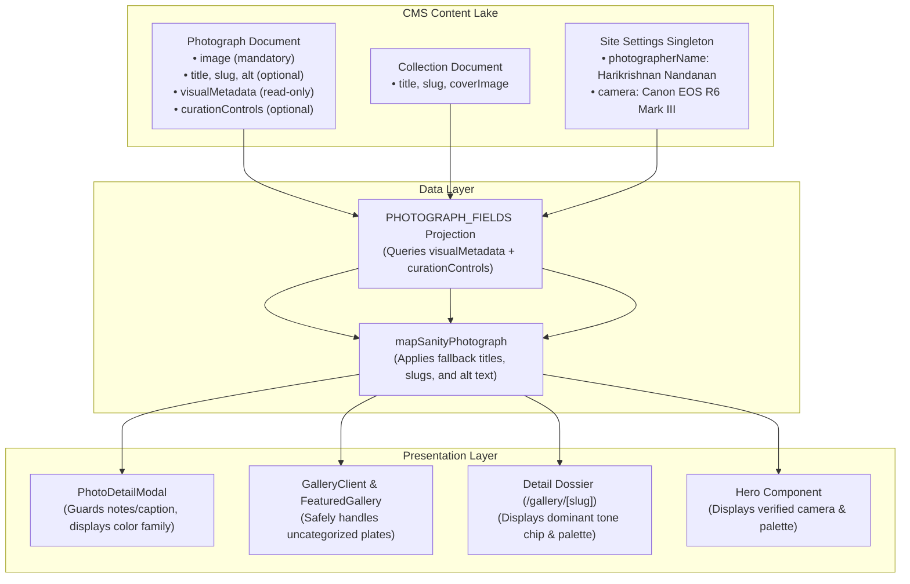

# PROJECT CONTEXT & HANDOFF SPECIFICATION

**Project:** Personal Travel Photography Portfolio × Fine-Art Exhibition  
**Concept:** "The Curated Monolith — An Intelligent Visual Journal"  
**Photographer:** Harikrishnan Nandanan  
**Watermark:** `HARI`  
**Copyright:** `© 2026 Hari. All rights reserved.`  
**Primary Camera:** Canon EOS R6 Mark III  
**Current Milestone:** Phase 4.5 Checkpoint B Complete (Zero-Friction Photography Archive Foundation)  
**Next Milestone:** Phase 4.5 Checkpoint C (Sanity Studio Bulk Uploader & Intake Pipeline)  
**Paused Milestone:** Phase 5 Stage C & D (Gallery/Detail Cinematic Page Transitions & Performance QA)

---

## 1. Project Vision & Creative Philosophy

### Core Creative Direction
* **Personal Portfolio × Fine-Art Exhibition Aesthetic:** The website is fundamentally a **personal travel photography journal for a hobbyist**, presented through the visual language and cinematic atmosphere of a premium fine-art exhibition (70% personal visual journal, 30% museum-grade fine-art exhibition).
* **Authentic Personal Identity:**
  * **Photographer:** Harikrishnan Nandanan.
  * **Role & Background:** A hobbyist photographer who travels, explores unfamiliar places, and takes photographs along the way.
  * **Personal Passion, Not a Business:** Photography is a personal creative pursuit and medium for documenting light, places, and memories. **Harikrishnan does not own a commercial studio, operate a business for hire, offer photography services, or have gallery representation.**
  * **Tagline:** *Photography · Travel · Visual Stories*
  * **Primary Camera:** **Canon EOS R6 Mark III**. (No unverified lens collections, artificial gear catalogues, or invented equipment).
  * **Watermark & Copyright:** Monumental footer watermark displays **`HARI`**; bottom colophon reads **`© 2026 Hari. All rights reserved.`**
* **Zero Fictional Claims:** The portfolio strictly eliminates all fabricated commercial jargon ("Studio & Inquiries", "Commissions Worldwide", "Available for Assignments"), fabricated awards, fake monographs, invented Biennales, or fake representation relationships. Factual contact information is decoupled into configurable placeholders in Sanity `siteSettings`.
* **Photographic Integrity & Equipment Attribution:** The Canon EOS R6 Mark III is Harikrishnan's authentic camera. Individual photograph EXIF fields are strictly optional. Photographic telemetry is displayed only when authentic data is available in Sanity; camera metadata is never fabricated.
* **The Exhibition Atmosphere:** Uses numbered exhibition plates (`PLATE 00`, `PLATE 01`...), thematic travel series (*Wanderings & Wild Places*, *City Streets & Travel Notes*, *Forms & Spaces*), editorial captions, and museum-grade negative space to give personal travel photography an elevated, cinematic presentation.

---

## 2. Approved Design System ("The Curated Monolith")

### Color Palette
* **Obsidian Foundation:** `#08080a` (Deepest canvas surface background)
* **Pitch Surface:** `#030304` (Sub-surface layer for modals, dossiers, and photo mats)
* **Carbon Cards:** `#111114` & `#141418` (Plate containers and card backgrounds)
* **Primary Text (Bone White):** `#f4f2ec` (Contrast ratio `18.2:1`, WCAG AAA compliant against `#08080a`)
* **Muted Text (Pewter):** `#c8c5bc` & `#a1a1aa` (Legible descriptions and technical metadata)
* **Exhibition Accents:** Warm Bronze `#d4a373` & Subtle Amber `#e09f58`
* **Hairline Borders:** `rgba(255, 255, 255, 0.08)` to `rgba(255, 255, 255, 0.15)`

### Typography Matrix
* **Editorial Display Serif:** *Cormorant Garamond* (Google Font weights 300, 400, 500, 600, and Italic). Used for plate titles, exhibition headlines, and curatorial quotes.
* **Body / Interface Sans:** *Inter* (`font-light`, `leading-relaxed`). Used for curatorial essays, personal biography, and interface labels.
* **Plate Telemetry Monospace:** *JetBrains Mono* (`tracking-[0.25em]`, uppercase). Used for plate numbers, camera telemetry, categories, and timestamps.
* **Preconnected Web Fonts:** Loaded via `<link>` in `src/app/layout.tsx` to eliminate build-time Google Font network failures.

### Textures & Atmosphere
* **Analogue Film Grain:** Embedded SVG fractal noise overlay (`.film-grain`) at 3% opacity with `pointer-events-none` across the viewport, providing an authentic silver-halide texture.
* **Lens Falloff Vignette:** Radial dark falloff gradient (`.vignette-overlay`) on hero imagery mimicking large-format lens characteristics.

---

## 3. Technology Stack & Exact Versions

* **Framework:** Next.js `16.4.6` (App Router)
* **UI Library:** React `19.3.0` & React DOM `19.3.0`
* **Motion Library:** `motion` `^12.4.7` (imported via `motion/react`)
* **Language:** TypeScript `^5` (Strict typing enabled in `tsconfig.json`)
* **Styling:** Tailwind CSS `4.3.3` with `@tailwindcss/postcss` `4.3.3`
* **Bundler Pipeline:** Webpack compiler pipeline (`next build --webpack` / `next dev --webpack`)
* **Icons:** `lucide-react@1.72.0`
* **CMS & Content Lake:** `sanity@^6.23.0`, `next-sanity@^13.4.0`, `@sanity/image-url@^2.1.1`, `@sanity/webhook@^5.0.0`
* **Image Optimization:** Next.js `<Image>` integrated with Sanity Image Asset Pipeline, hotspot/crop coordinates, and zero-CLS `lqip` base64 blur placeholders.

---

## 4. Completed Phases & Project History

### Phases 1–4: Core Foundation & CMS Integration (Completed)
* **Phase 1: Architecture & Theme Foundation:** Setup Next.js App Router, Tailwind 4 theme, fine-art design system, typography matrix, and mock data models.
* **Phase 2: Core Components & Layout:** Implemented Navigation, Hero, EditorialIntro, FeaturedGallery, SeriesShowcase, AboutSection, and Footer.
* **Phase 3: Route Architecture:** Built full `/gallery`, `/gallery/[slug]`, `/collections`, and `/collections/[slug]` routes with responsive fine-art plate dossiers.
* **Phase 4: Sanity CMS & On-Demand ISR:** Embedded Sanity Studio at `/studio`, created Sanity schemas (`photograph`, `collection`, `siteSettings`), integrated deterministic mappers, implemented secure authenticated Draft Mode (`/api/draft-mode/enable|disable`), and configured HMAC-SHA256 webhook cache revalidation (`/api/revalidate`).

### Phase 5: Cinematic Animations & Micro-interactions (Stage A & B Complete, C & D Paused)
* **Stage A: Motion Architecture & Reusable Primitives (Completed):**
  * Integrated `motion/react` with React 19 compatibility.
  * Created `src/lib/motion.ts` with shared editorial easings (`[0.16, 1, 0.3, 1]`), durations, and stagger presets.
  * Built `MotionProvider` respecting `prefers-reduced-motion` while keeping `layout.tsx` as a Server Component.
  * Implemented reusable primitives: `ScrollReveal`, `TextReveal`, and `ImageVeil`.
  * Verified in real browser with zero hydration mismatches, zero SSR layout shifts, and full reduced-motion accessibility.
* **Stage B: Homepage Cinematic Enhancements (Completed):**
  * **Checkpoint B1 (Hero & Navigation):** Subtle scale settle ($1.04 \to 1.00$) on hero background image; staggered editorial headline reveals; sticky navigation backdrop blur and threshold transitions.
  * **Checkpoint B2 (Editorial Intro & Featured Gallery):** Downward bronze accent line draw; staggered narrative reveals; plate scroll reveals with selective `ImageVeil`; spring-animated active category filter pills.
  * **Checkpoint B3 (About Section & Monumental Footer):** Scroll-triggered portrait reveal; personal philosophy entrance; Canon EOS R6 Mark III telemetry slate reveal; monumental `HARI` watermark entrance.
* **Stage C & D (Paused):** Gallery/detail page transition choreography and final cross-browser animation QA are paused while Phase 4.5 intelligent archive capabilities are built.

---

## 5. Phase 4.5: Intelligent Photography Archive

### Checkpoint A: Architectural Decisions & Mathematical Formulation (Completed)
1. **Perceptual Color Sequencing ($\Delta E^*_{ab}$):**
   * Replaced raw RGB Euclidean distance with CIE $L^*a^*b^*$ perceptual color distance to match human visual perception.
   * Color distance metric:
     $$\Delta E^*_{ab} = \sqrt{(\Delta L^*)^2 + (\Delta a^*)^2 + (\Delta b^*)^2}$$
2. **Normalized Transition Cost Formula:**
   * Sequence transition cost is computed by normalizing all factors to $[0, 1]$ before applying weights:
     $$C(A, B) = w_c \cdot \frac{\Delta E^*_{ab}}{100} + w_l \cdot \frac{|\Delta L^*|}{100} + w_s \cdot |\Delta S| + w_a \cdot \Delta_{aspect} + w_o \cdot \Delta_{orient} + w_g \cdot \Delta_{genre}$$
3. **Curation Overrides & Conflict Resolution:**
   * Handled arbitrary 1-indexed `pinnedPosition` values.
   * If conflicts occur (multiple photographs requesting the same position), tie-breaking favors manual curator priority, followed by creation timestamp, shifting remaining items to the next open slot.
   * Punctuation plates (`forcePunctuation: true`) act as intentional visual breaks, inserting high-contrast plates at rhythm intervals.
4. **Decoupled Hero Selection:**
   * Homepage hero selection is decoupled from gallery sequence ordering (hero chosen via aspect ratio, resolution, and aesthetic prominence score; gallery ordered via sequence continuity).
5. **Sequence Stability & Snapshot Invalidation:**
   * Prevents full-archive reshuffling upon publishing new photographs using movement-bounded sequence insertion.
   * Sequence snapshots are cached in Next.js ISR and recomputed on-demand via Sanity webhooks.

---

### Checkpoint B: Zero-Friction Photography Archive Foundation (Completed)

#### Schema Transformation (`photograph.ts`)
* **Made Mandatory Editorial Fields Optional:**
  * `title`: Optional (`validation: (Rule) => Rule.optional()`). Falls back to `Plate ${plateNumber}` or `"Untitled Plate"`.
  * `slug`: Optional. Auto-derived from title, plate number, or document ID.
  * `image.alt`: Optional. Falls back to caption, title, or curatorial description.
  * `category`: Optional. Photographs without category remain fully visible in the visual journal under `"ALL"`.
  * `displayOrder`: Optional. Replaced by automated intelligent sequencing.
* **Added `visualMetadata` (Read-Only Object):**
  * Contains automated pipeline metrics: `status` (`pending` | `analyzed` | `failed`), `version`, `sourceAssetRef`, `analyzedAt`, `dominantColor` (Hex, RGB, HSL, LAB), `palette[]` (Hex, RGB, HSL, LAB, population, role), `brightness`, `contrast`, `saturation`, `colorTemperature`, `colorFamily`, `orientation`, `aspectRatioNumeric`, and `error`.
  * Marked `readOnly: true` and collapsed by default in Studio.
* **Added `curationControls` (Editable Overrides Object):**
  * Contains manual curator overrides: `pinnedPosition` (integer $\ge 1$), `forcePunctuation` (boolean), `manualColorFamily` (enum override).
* **Enhanced Studio Preview:**
  * Preview `prepare()` safely renders untitled plates and displays palette classifications alongside genre labels.

#### Data Layer & Projections
* **`src/sanity/lib/types.ts`:** Defined `ColorFamily`, `ImageOrientation`, `ColorSwatch`, `PhotographVisualMetadata`, `CurationControls`, and updated `SanityPhotographDoc`.
* **`src/lib/data.ts`:** Updated public `Photograph` interface with optional `category`, optional `displayOrder`, `isHero`, `visualMetadata`, and `curationControls`.
* **`src/sanity/lib/queries.ts`:** Expanded `PHOTOGRAPH_FIELDS` GROQ projection to query full `visualMetadata` and `curationControls` structures.
* **`src/sanity/lib/mappers.ts`:** Hardened `mapSanityPhotograph` with defensive fallbacks for title, slug, and alt text.

#### Frontend Component Hardening
* **`PhotoDetailModal.tsx`:** Curatorial notes and captions render only when non-empty strings exist; category row falls back to `photo.visualMetadata?.colorFamily` or `"Visual Archive"`; placeholder disclaimer note guarded.
* **`app/gallery/[slug]/page.tsx`:** Category row switches dynamically to `Palette: <colorFamily>` if genre is undefined; added dominant tone color swatch; curatorial notes and captions guarded.
* **`FeaturedGallery.tsx`:** Guarded filter predicate `p.category?.toUpperCase() === selectedCategory`; plate metadata bars display genre or palette; sample notes guarded.
* **`GalleryClient.tsx`:** Category filter safely displays uncategorized plates under `"ALL"`; plate metadata labels adapt dynamically.
* **`Hero.tsx`:** Telemetry bar gracefully handles undefined categories.
* **`app/collections/[slug]/page.tsx`:** Guarded metadata bars against undefined categories.

---

## 6. The Agreed Zero-Friction CMS Workflow

The overarching operational workflow for Harikrishnan's archive:

```
┌─────────────────────────────────────────────────────────────┐
│ 1. Bulk Upload N Photographs                                │
│    Photographer drags & drops arbitrary Lightroom exports    │
│    into Sanity Studio in a single action.                   │
└──────────────────────────────┬──────────────────────────────┘
                               │
                               ▼
┌─────────────────────────────────────────────────────────────┐
│ 2. Automated Document Creation                              │
│    System generates individual `photograph` documents,       │
│    assigns unique slugs, and assigns plate numbers.         │
│    Title, description, category remain blank/optional.      │
└──────────────────────────────┬──────────────────────────────┘
                               │
                               ▼
┌─────────────────────────────────────────────────────────────┐
│ 3. Automated Visual Analysis                                │
│    Pipeline processes image buffer:                          │
│    - Extracts dominant color & palette (Hex, RGB, HSL, LAB)  │
│    - Calculates perceptual brightness, contrast, saturation │
│    - Classifies color family & geometric orientation        │
│    - Updates `visualMetadata` with status: "analyzed"       │
└──────────────────────────────┬──────────────────────────────┘
                               │
                               ▼
┌─────────────────────────────────────────────────────────────┐
│ 4. Intelligent Visual Sequencing                            │
│    Sequencing algorithm orders plates using normalized       │
│    perceptual cost formula and respects `curationControls`. │
└──────────────────────────────┬──────────────────────────────┘
                               │
                               ▼
┌─────────────────────────────────────────────────────────────┐
│ 5. Automated Publication & Revalidation                     │
│    Documents are published; Sanity webhook triggers Next.js │
│    on-demand ISR tag revalidation ("photographs").          │
│    Photographs appear in live gallery immediately.          │
└─────────────────────────────────────────────────────────────┘
```

**Key Principle:** The photographer can write titles, captions, or curate specific pinned positions whenever desired, but **the system never demands manual data entry to publish photographs beautifully**.

---

## 7. Current Project Structure

```
photography-portfolio/
├── package.json                   # Dependencies, build scripts & overrides
├── postcss.config.mjs             # PostCSS plugin registration (@tailwindcss/postcss)
├── next.config.ts                 # Next.js config (AVIF/WebP, cdn.sanity.io remote pattern)
├── sanity.config.ts               # Embedded Sanity Studio configuration at /studio
├── tsconfig.json                  # Strict TypeScript configuration
├── PROJECT_CONTEXT.md             # Master project context and handoff document
├── .env.example                   # Environment variable template
│
└── src/
    ├── app/
    │   ├── layout.tsx             # Root layout: font preconnect, MotionProvider, film grain
    │   ├── globals.css            # Tailwind 4 @theme, custom palette, grain utilities
    │   ├── page.tsx               # Homepage Server Component
    │   │
    │   ├── api/
    │   │   ├── draft-mode/
    │   │   │   ├── enable/route.ts   # Secure Draft Mode activation
    │   │   │   └── disable/route.ts  # Clears bypass cookie
    │   │   └── revalidate/
    │   │       └── route.ts          # HMAC-SHA256 verified Sanity webhook (ISR)
    │   │
    │   ├── gallery/
    │   │   ├── layout.tsx         # Gallery metadata shell
    │   │   ├── page.tsx           # Gallery Server Component
    │   │   ├── GalleryClient.tsx  # Interactive gallery (dual filtering, modal states)
    │   │   └── [slug]/
    │   │       ├── page.tsx       # Dynamic plate dossier (dynamicParams = true)
    │   │       └── not-found.tsx  # Fine-art 404 plate
    │   │
    │   ├── collections/
    │   │   ├── layout.tsx         # Collections metadata shell
    │   │   ├── page.tsx           # Collections index
    │   │   └── [slug]/
    │   │       ├── page.tsx       # Journey dossier
    │   │       └── not-found.tsx  # Fine-art 404 plate
    │   │
    │   └── studio/
    │       └── [[...tool]]/
    │           ├── page.tsx       # Studio mount page
    │           └── Studio.tsx     # NextStudio client wrapper
    │
    ├── components/
    │   ├── Navigation.tsx         # Route-aware header with motion blur & mobile drawer
    │   ├── Hero.tsx               # Hero presentation with scale settle & staggered typography
    │   ├── EditorialIntro.tsx     # Narrative intro with vertical line draw & staggered reveals
    │   ├── FeaturedGallery.tsx    # Homepage featured plates with ImageVeil & spring filter pills
    │   ├── SeriesShowcase.tsx     # Curated travel journeys
    │   ├── AboutSection.tsx       # Personal bio, Canon EOS R6 Mark III, portrait reveal
    │   ├── Footer.tsx             # "Let's Connect", monumental HARI watermark, © 2026 Hari
    │   ├── PhotoDetailModal.tsx   # Plate inspector modal with defensive fallbacks
    │   ├── CopyLinkButton.tsx     # Clipboard copy button with tactile visual state
    │   ├── DraftPreviewBanner.tsx # Status banner for active Draft Mode sessions
    │   ├── HomePageClient.tsx     # Client container for homepage modals
    │   └── motion/                # Stage A reusable motion primitives
    │       ├── index.ts           # Barrel export
    │       ├── MotionProvider.tsx # Client motion context with reduced-motion support
    │       ├── ScrollReveal.tsx   # Viewport scroll trigger primitive
    │       ├── TextReveal.tsx     # Accessible editorial typography reveal
    │       └── ImageVeil.tsx      # Curatorial image shutter entrance
    │
    ├── lib/
    │   ├── data.ts                # Application data model, Photograph types, fetchers
    │   └── motion.ts              # Motion design tokens (easings, durations, springs)
    │
    └── sanity/
        ├── env.ts                 # Sanity env accessors
        ├── structure.ts           # Desk structure locking siteSettings singleton
        ├── schemaTypes/
        │   ├── photograph.ts      # Zero-friction Photograph schema (visualMetadata, curationControls)
        │   ├── collection.ts      # Travel journey schema
        │   ├── siteSettings.ts    # Singleton schema for photographer bio, camera, contact
        │   └── index.ts           # Schema registration index
        └── lib/
            ├── client.ts          # createClient, sanityFetch with draftMode and cache tags
            ├── image.ts           # urlForImage builder, resolveImageUrl with crop/hotspot
            ├── queries.ts         # Pure GROQ queries (PHOTOGRAPH_FIELDS with visualMetadata)
            ├── types.ts           # TypeScript interfaces (SanityPhotographDoc, VisualMetadata)
            └── mappers.ts         # Deterministic mappers with defensive fallbacks
```

---

## 8. Current Sanity Schema Definitions & Data Flow



---

## 9. Verification Status & Known Limitations

### Verification Status
* **TypeScript Compiler (`npx tsc --noEmit`):** Passes with **0 errors**.
* **Production Build (`npm run build`):** Compiles cleanly with exit code `0`. All 11 static pages generated:
  * `/` (Static)
  * `/_not-found`
  * `/api/draft-mode/disable`
  * `/api/draft-mode/enable`
  * `/api/revalidate`
  * `/collections` (Static)
  * `/collections/[slug]` (SSG)
  * `/gallery` (Static)
  * `/gallery/[slug]` (SSG)
  * `/studio/[[...tool]]` (Dynamic)

### Known Limitations & Pending Work
1. **Sharp Not Yet Installed:** Image processing library `sharp` is intentionally not installed yet; it will be introduced in the analysis pipeline.
2. **Analysis Pipeline Pending:** Documents currently have `visualMetadata.status: "pending"` by default until the automated analysis pipeline (worker/webhook) is implemented.
3. **Sequencing Hook Pending:** The gallery currently displays items ordered by legacy `displayOrder asc, _createdAt desc` until the visual sequencing algorithm is integrated with the presentation layer.
4. **Live Dataset Population:** The Sanity dataset currently contains plate `test 1` and `siteSettings`. Mock data serves as a fallback reference when Sanity returns empty arrays or when `NEXT_PUBLIC_USE_MOCK_DATA="true"`.

---

## 10. Next Milestone: Phase 4.5 Checkpoint C

### Scope: Sanity Studio Bulk Uploader & Intake Pipeline
The next checkpoint will implement the bulk intake mechanism:
1. **Multi-File Upload Component / Action:** Custom tool or Studio input component allowing the photographer to select $N$ files simultaneously from disk.
2. **Deterministic Document Generation:** Creates individual `photograph` documents with:
   - Asset upload to Sanity CDN.
   - Deterministic slug (from sanitized filename or timestamp).
   - Plate numbering assignment.
   - Initial `visualMetadata.status: "pending"`.
   - Immediate publish or draft creation according to configuration.
3. **Decoupled Architecture:** Upload finishes instantaneously; analysis runs asynchronously without blocking the user.
4. **Idempotency & Error Handling:** Prevents duplicate uploads of the same asset; isolates failures to single plates without failing the entire batch.

---

## 11. Core Invariants & Preservation Rules

Any agent or developer continuing this project **MUST** uphold these rules:

1. **Preserve Authentic Identity:**
   * Photographer: **Harikrishnan Nandanan**
   * Camera: **Canon EOS R6 Mark III**
   * Watermark: **`HARI`**
   * Copyright: **`© 2026 Hari. All rights reserved.`**
   * Never invent commercial studio services, client booking forms, fake awards, or fictional photographic narratives.
2. **Preserve Design System ("The Curated Monolith"):**
   * Dark editorial aesthetic (`#08080a`, `#f4f2ec`, `#d4a373`).
   * Typography: Cormorant Garamond (Serif), Inter (Sans), JetBrains Mono (Telemetry Monospace).
   * Analog film grain and vignette overlays.
3. **Preserve Phase 5 Motion & Architecture:**
   * Keep `ScrollReveal`, `TextReveal`, `ImageVeil`, and `motion/react` integration intact.
   * Root layout must remain a **Server Component**.
   * Respect `prefers-reduced-motion` at all times.
   * Avoid full-page hydration flashes or content hidden from non-JS visitors.
4. **Preserve Sanity Integration:**
   * Maintain the embedded Sanity Studio at `/studio`.
   * Keep authenticated Draft Mode and HMAC-SHA256 ISR revalidation functional.
   * Public GROQ queries must enforce `!(_id in path("drafts.**"))`.
5. **Preserve Zero-Friction Principles:**
   * Never re-introduce mandatory editorial fields on photographs.
   * Keep `visualMetadata` separated from manual `curationControls`.
